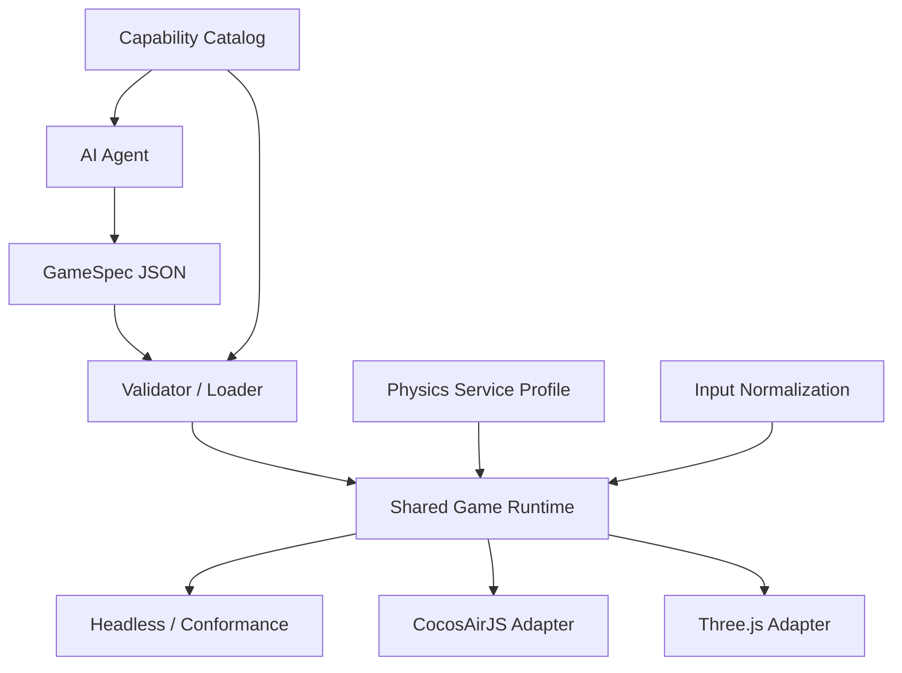

# A2Game V0.1 — 正式协议设计包（设计稿，尚未实现）

- 版本：`0.1.0-draft.1`
- 日期：2026-10-24
- 目标：AI 直接生成引擎无关 JSON，由共享 Game Runtime 解释，CocosAirJS / Three.js 作为可替换适配器；覆盖益智、休闲、轻量射击、塔防、合成、经营，Touch / IMU 是正式输入通道。
- 状态：**规范设计和结构校验样例**，不代表引擎实现、运行端到端验证或官方标准发布。

## 阅读顺序及规范层级

| 顺序 | 文件 | 规范对象 |
|---|---|---|
| 1 | [`docs/01-GameSpec-V0.1.md`](docs/01-GameSpec-V0.1.md) | GameSpec 内容结构与语义 |
| 2 | [`docs/02-Capability-Manifest-V0.1.md`](docs/02-Capability-Manifest-V0.1.md) | 能力目录、版本协商、Touch / IMU / 模块扩展 |
| 3 | [`docs/03-Runtime-Tick-Rule-Semantics-V0.1.md`](docs/03-Runtime-Tick-Rule-Semantics-V0.1.md) | Tick、规则、冲突、随机、状态与生命周期 |
| 4 | [`docs/04-Conformance-Test-V0.1.md`](docs/04-Conformance-Test-V0.1.md) | 基线测试、黄金样例、跨引擎适配验收 |
| 附录 | [`docs/05-Coverage-Registry-V0.1.md`](docs/05-Coverage-Registry-V0.1.md) | 32 个候选游戏 + 未来扩展覆盖数据模型 |

## 机器可读草案

- `schemas/`：采用 JSON Schema Draft 2020-12 的 7 份**结构 Schema 草案**；不包含所有跨字段语义约束。
- `samples/games/tap-target.game.json`：最小可执行意图样例（需要未实现的 Runtime）。
- `samples/capabilities/*.capability.json`：标准能力声明样例（**并非能力实现**）。
- `samples/tests/*.conformance.json`：一致性测试格式和期望结果（**尚未实际通过**）。
- `samples/tests/touch-imu.input-trace.json`：Touch + IMU 标准化录制格式样例（采样数据为合成示例）。
- `samples/tests/negative-fixtures.json`：应当报错的 7 条结构/语义负例。
- `samples/coverage/games.json`：32 个候选玩法的可扩展登记数据。
- `samples/coverage/not-run.receipt.json`：明确 NOT_RUN 的验收回执样例。
- `samples/adapters/*.adapter.json`：CocosAirJS / Three.js 的**计划声明**，未冒充 verified。
- `tools/validate_specs.py`：仅进行 JSON / Schema / 静态交叉引用校验和部分负例检查，不启动游戏，不提供逻辑或渲染实现。
- `tools/build_artifacts.py`：重建 Schema / 示例数据，便于规范修订后重验。

### 离线验证

```bash
python -m pip install jsonschema
python tools/validate_specs.py
```

注意：校验 PASS 仅证明示例数据满足当前静态格式与少量引用规则，**不证明玩法实现和跨引擎兼容**。

## 本轮可执行交付范围

1. 统一 `specVersion = 0.1.0`、能力精确版本引用与可扩展的 CoverageRegistry。
2. 提供 7 份结构 Schema、1 份最小 GameSpec、7 份能力 Manifest、2 份 Conformance Suite、RNG 黄金向量、Touch/IMU InputTrace、32 条候选玩法以及未运行回执。
3. 提供静态交叉校验（已测试）；**不提供游戏运行时、CocosAirJS/Three.js Adapter 或真实性能测试**。

## 四层边界



- A2Game 拥有：逻辑状态、规则解释、时钟、事件、随机、玩法模块和测试标准。
- 适配器拥有：画面、材质、粒子、声画呈现、设备事件采样和宿主资源生命周期。
- 物理/导航属于独立服务，尽可能同一实现；不能因共享 JSON 就假定不同求解器数值一致。

## 规范冲突处理

- 这四份文件共同构成 `0.1.0-draft.1`，不存在以“某份文档默认值”为由覆盖另一份的规则。
- 结构字段以 GameSpec 和 Manifest 文档为准；Tick/Rule 行为以 Runtime 文档为准；验证结果判定以 Conformance 文档为准。
- 如出现冲突，属于**规范缺陷**，必须修改两份文档和相关 test vector 后才能标记已解决；不允许实现自行择一。

## 明确不在 V0.1 已实现范围内

多人网络同步、任意用户脚本执行、独立视觉编辑器、跨物理后端 bit-exact、任意已有 TS 游戏的无损反向导出。可以通过扩展能力进行未来设计，但不默示这些能力已提供。

## 来源与原创边界

协议是本项目的设计稿。参考 [A2UI Catalogs](https://a2ui.org/concepts/catalogs/)、[Yume 的世界模型/一致性契约](https://github.com/kamwoh/yume/blob/dev/docs/guideline/30_framework_primitives.md)、[JSON Schema 2020-12](https://json-schema.org/draft/2020-12)、[W3C Pointer Events 3](https://www.w3.org/TR/pointerevents3/)、[MDN DeviceMotionEvent](https://developer.mozilla.org/en-US/docs/Web/API/DeviceMotionEvent)，而非复用其协议或宣称兼容。
