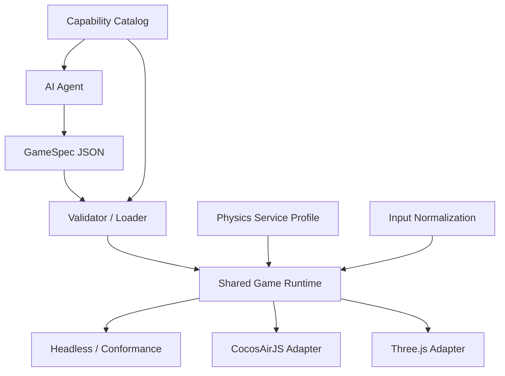

# A2Game V0.1 — 正式设计规范全集

版本：`0.1.0-draft.1`。本文件合并了四份主体规范和 Coverage Registry 附录；样例 JSON / Schema / 校验脚本请下载完整 ZIP。


---

<!-- Source: README.md -->

# A2Game V0.1 — 正式协议设计包（设计稿，尚未实现）

- 版本：`0.1.0-draft.1`
- 日期：2026-10-24
- 目标：AI 直接生成引擎无关 JSON，由共享 Game Runtime 解释，CocosAirJS / Three.js 作为可替换适配器；覆盖益智、休闲、轻量射击、塔防、合成、经营，Touch / IMU 是正式输入通道。
- 状态：**规范设计和结构校验样例**，不代表引擎实现、运行端到端验证或官方标准发布。

## 阅读顺序及规范层级

| 顺序 | 文件 | 规范对象 |
|---|---|---|
| 1 | [`docs/01-GameSpec-V0.1.md`](docs/01-GameSpec-V0.1.md) | GameSpec 内容结构与语义 |
| 2 | [`docs/02-Capability-Manifest-V0.1.md`](docs/02-Capability-Manifest-V0.1.md) | 能力目录、版本协商、Touch / IMU / 模块扩展 |
| 3 | [`docs/03-Runtime-Tick-Rule-Semantics-V0.1.md`](docs/03-Runtime-Tick-Rule-Semantics-V0.1.md) | Tick、规则、冲突、随机、状态与生命周期 |
| 4 | [`docs/04-Conformance-Test-V0.1.md`](docs/04-Conformance-Test-V0.1.md) | 基线测试、黄金样例、跨引擎适配验收 |
| 附录 | [`docs/05-Coverage-Registry-V0.1.md`](docs/05-Coverage-Registry-V0.1.md) | 32 个候选游戏 + 未来扩展覆盖数据模型 |

## 机器可读草案

- `schemas/`：采用 JSON Schema Draft 2020-12 的 7 份**结构 Schema 草案**；不包含所有跨字段语义约束。
- `games/tap-target.game.json`：最小可执行意图样例（需要未实现的 Runtime）。
- `capabilities/*.capability.json`：标准能力声明样例（**并非能力实现**）。
- `tests/*.conformance.json`：一致性测试格式和期望结果（**尚未实际通过**）。
- `examples/input-traces/touch-imu.input-trace.json`：Touch + IMU 标准化录制格式样例（采样数据为合成示例）。
- `tests/negative-fixtures.json`：应当报错的 7 条结构/语义负例。
- `coverage/games.json`：32 个候选玩法的可扩展登记数据。
- `examples/coverage/not-run.receipt.json`：明确 NOT_RUN 的验收回执样例。
- `adapters/*.adapter.json`：CocosAirJS / Three.js 的**计划声明**，未冒充 verified。
- `tools/validate_specs.py`：仅进行 JSON / Schema / 静态交叉引用校验和部分负例检查，不启动游戏，不提供逻辑或渲染实现。
- `tools/build_artifacts.py`：重建 Schema / 示例数据，便于规范修订后重验。

### 离线验证

```bash
python -m pip install jsonschema
python tools/validate_specs.py
```

注意：校验 PASS 仅证明示例数据满足当前静态格式与少量引用规则，**不证明玩法实现和跨引擎兼容**。

## 本轮可执行交付范围

1. 统一 `specVersion = 0.1.0`、能力精确版本引用与可扩展的 CoverageRegistry。
2. 提供 7 份结构 Schema、1 份最小 GameSpec、7 份能力 Manifest、2 份 Conformance Suite、RNG 黄金向量、Touch/IMU InputTrace、32 条候选玩法以及未运行回执。
3. 提供静态交叉校验（已测试）；**不提供游戏运行时、CocosAirJS/Three.js Adapter 或真实性能测试**。

## 四层边界



- A2Game 拥有：逻辑状态、规则解释、时钟、事件、随机、玩法模块和测试标准。
- 适配器拥有：画面、材质、粒子、声画呈现、设备事件采样和宿主资源生命周期。
- 物理/导航属于独立服务，尽可能同一实现；不能因共享 JSON 就假定不同求解器数值一致。

## 规范冲突处理

- 这四份文件共同构成 `0.1.0-draft.1`，不存在以“某份文档默认值”为由覆盖另一份的规则。
- 结构字段以 GameSpec 和 Manifest 文档为准；Tick/Rule 行为以 Runtime 文档为准；验证结果判定以 Conformance 文档为准。
- 如出现冲突，属于**规范缺陷**，必须修改两份文档和相关 test vector 后才能标记已解决；不允许实现自行择一。

## 明确不在 V0.1 已实现范围内

多人网络同步、任意用户脚本执行、独立视觉编辑器、跨物理后端 bit-exact、任意已有 TS 游戏的无损反向导出。可以通过扩展能力进行未来设计，但不默示这些能力已提供。

## 来源与原创边界

协议是本项目的设计稿。参考 [A2UI Catalogs](https://a2ui.org/concepts/catalogs/)、[Yume 的世界模型/一致性契约](https://github.com/kamwoh/yume/blob/dev/docs/guideline/30_framework_primitives.md)、[JSON Schema 2020-12](https://json-schema.org/draft/2020-12)、[W3C Pointer Events 3](https://www.w3.org/TR/pointerevents3/)、[MDN DeviceMotionEvent](https://developer.mozilla.org/en-US/docs/Web/API/DeviceMotionEvent)，而非复用其协议或宣称兼容。


---

<!-- Source: docs/01-GameSpec-V0.1.md -->

# A2Game GameSpec V0.1

**版本**：`0.1.0-draft.1` · **状态**：拟议规范 · **约束性**：本文件带 MUST/SHOULD/MAY 的条款属于未来实现的验收要求；尚未有符合实现。 

## 1. 目标、非目标与术语

**目标**：AI 按能力目录生成规范化 JSON，单份内容可由 Headless Runtime、CocosAirJS、Three.js 适配器装载，在约定相同的逻辑/物理服务下执行相同玩法结果。V0.1 的设计覆盖益智、休闲、实时射击、塔防、合成和轻经营；未来棋牌、RPG、联机、AR/传感器扩展不更改 Core 基本形状。

**不是**：Cocos 序列化数据、Three.js `Object3D.toJSON`、通用编程语言、任意 TS/JS 解释器、可替代素材生成器的格式。不能把任意已有 TS 代码无损转成 JSON；新行为通过已审核能力注册。

定义：
- `GameDefinition`：静态、可版本化的游戏内容，解析后不可被实时规则直接改变；`revision` 是创作版本。
- `GameSession`：某一次运行的状态、时钟、随机状态、延时事件/计时器及生命周期；与 Definition 不同。
- `Capability`：注册表中具备 Schema、命令、事件、状态和执行语义的能力。
- `Host`：呈现/设备/资源环境；CocosAirJS/Three.js 属于 Host Adapter，不拥有玩法权威状态。
- `Logical Tick`：共享 Runtime 的离散时钟步，不等于浏览器 `requestAnimationFrame` 或物理引擎内部 substep。

使用 MUST/MUST NOT/SHOULD/MAY 区分规范强度。`0.1.0` 是拟议协议的具体版本；文本状态 `draft.1` 不构成已发布兼容承诺。

## 2. 文档结构（规范）

`format = "a2game"`、`specVersion`、`id`、`revision`、`meta`、`requires`、`world`、`scenes`、`entryScene`、`state`、`inputs`、`rules`、`outcomes`、`presentation` 为必需字段（允许空对象或空数组的字段详见 Schema）；其余为可选。未知顶级字段 MUST 拒绝（`A2G_E_UNKNOWN_FIELD`）；扩展写入 `extensions` 并声明提供者。

| 属性 | 类型与说明 | 关键约束 |
|---|---|---|
| `format` / `specVersion` | 固定 `a2game` / `0.1.0` | 不支持版本报 `A2G_E_SPEC_VERSION`；不得静默降级 |
| `id` / `revision` | 稳定内容标识 / 正整数修订号 | 标识跨改名稳定，修订号严格递增 |
| `meta` | 标题、描述、作者、`genres`、说明 | 分类**不影响运行语义**，分类表开放注册 |
| `requires` | `{all:[CapabilityRef], anyOf:[[CapabilityRef,...],...]}` | 所有 `all` 必须满足；每组 `anyOf` 至少一个满足；空组拒绝 |
| `world` | `dimension`、`coordinateSystem`、`units`、`clock` | V0.1：`2d/3d`、右手 Y 轴向上、米；逻辑 `tickHz` 推荐 60，可为 30/60/120 |
| `assets` | 资源逻辑 ID → `uri/type/integrity?` | 不允许 `javascript:` 或任意远程下载；受宿主白名单约束 |
| `prototypes` | 对象原型字典 | 静态定义；实例化继承后按实例 override，不能覆盖 capability ID |
| `scenes` / `entryScene` | 场景数组 / 入口 ID | 场景 ID 唯一；初始仅一活动场景，切换需释放旧对象 |
| `state` | 全局命名状态字段：`type, initial, constraints?` | 运行时 `state` 值属于 Session，不写回 Definition |
| `inputs` | 语义动作定义与设备绑定 | `source` 用能力 ID/注册源别名，不能引用原生 DOM 回调 |
| `rules` | `id/priority/on/if/do` 数组 | `on` 使用事件类型，`if` 是受限 AST，`do` 为已注册操作 |
| `outcomes` | 终局条件数组 | 仅在 `S_post` 评估，按 `priority`→`id` 确定首个结果 |
| `presentation` | HUD、画面绑定与特效提示 | 只观察逻辑状态，不具备修改玩法状态的隐式权限 |
| `tests` | 相对路径测试文件引用 | 测试不是游戏逻辑；禁止带绝对文件路径 |
| `extensions` | URI/命名空间映射扩展数据 | 必须与 Capability Manifest 的 extension Schema 匹配 |

### 2.1 引用与标识

- `Game.id` 建议反向域名，如 `org.a2game.samples.tap-target`；实体、场景、原型、规则使用稳定、大小写敏感 ID。禁止重复或保留前缀 `_a2game`。
- 外部引用一律通过资源逻辑 ID、实体 ID、能力 ID 或 `sceneId`，不能通过原生 Node/Object3D 内存句柄。
- 全局状态路径使用 RFC 6901 风格 JSON Pointer，例如 `/score`；默认只读已声明字段；数组/对象索引的特殊写入由对应能力提供。
- 稳态路径 `/state`、`/entities` 与 `/flow` 是测试观察协议的固定根；声明期的 `state` 字段定义和运行时 `/state` 数据不是同一个对象。
- 初始实体 ID 与动态生成 ID 分域；动态 ID 由 Runtime 以 `spawn:<prototype>:<tick>:<counter>` 生成（计数在 Session 内单调递增），不得由宿主图形 API 决定。

### 2.2 世界空间、坐标与数值

- 世界空间右手系、`+X` 向右、`+Y` 向上、2D 位于 XY 平面，3D 前方为 `-Z`；线性单位米、角度弧度。
- UI 使用布局坐标；Raw Pointer 使用 Viewport 归一化坐标，原点左上、`u` 向右、`v` 向下，范围 `[0,1]`。两者到世界空间的映射由 Adapter + Camera Contract 提供；不得直接将 screen pixel 当作 world meter。
- `int` 是 `[-(2^53-1), 2^53-1]` 内安全整数；`number` 是有限 IEEE-754 binary64。拒绝 NaN/Infinity、非法类型、溢出到无穷。
- `bool/string/int/number/vec2/vec3/enum/entityRef/array/object` 可由状态 Schema 声明。Core 精确一致性优先覆盖整数、布尔、标识和离散结构；浮点与物理使用显式容差契约。
- 渲染色值建议统一为 sRGB hex/RGBA，线性光照和 HDR 效果由适配器实现，详情进入渲染能力扩展规范。

## 3. 场景、实体与机制

一个 `scene` 声明 `{id, entities:[...]}`；实体形状：`{id, prototype?, tags?, state?, transform?, components?}`。`transform` 可由物理模块拥有写权，禁止渲染节点直接改写玩法 transform。

`prototype` 是对象模板，不是“完整游戏模板”；它声明默认状态、标签与模块。`components[]` 为 `{capability, config}`，其 `config` 由匹配 Manifest 的 `configSchema` 校验。逻辑组件（`merge`、`weapon`、`inventory`）运行在 Shared Runtime；表现组件（`sprite`、`mesh`、`material`）只更新适配器视图。

多个运行实体**允许复用原型定义**，但拥有独立实例状态。含可变对象的 `initial` MUST 深拷贝；渲染组件的本地缓存不得进入 GameSession 的可哈希状态。

## 4. 输入与游戏动作

### 4.1 分层（正式合同）

`Device Source → Normalized Sample → Gesture/Motion Recognizer → Semantic Action → Rule/Module`。输入设备接口不属于 GameSpec 的场景节点。游戏只订阅语义动作（`select`, `move`, `aim`, `fire`, `drag`, `steer`）。

原始输入来源：`pointer`（鼠标/触摸/笔，支持多触点）、键盘、手柄（未来）、IMU（加速度/角速度/姿态）；受权限与设备能力约束。`touch.tap` 等识别器运行在可版本化 Input Capabilities 中。

### 4.2 行为和边沿

动作值类型：`button | axis1 | vec2 | vec3 | pose`。`button` 使用 `press/hold/release/cancel`，`press→release→press` 即使落在同一 tick 也必须保留完整有序事件，不能合并为单个 bool。

- `cancel` 不等于 `release`：不执行“释放成功”“投射物发射”等效果。
- `pointerId` 在一次接触生命周期内稳定；`capture` 后 HUD 与游戏区不可重复消费同一触点。
- `first-ready` 输入优先级仅在设备来源变更或失效时重新选择；替代输入需明确定义于 `bindings`，不能暗中合成触摸/IMU。
- 输入异步请求权限，只允许显式用户激活；拒绝后须发 `A2G_INPUT_PERMISSION_DENIED`，然后根据声明的替代方案处理。
- IMU 适配器明确设备参考系、屏幕方向、角速度 `rad/s`、线性加速度 `m/s²`、零点校准和缺采样状态；`absolute=false` 的相对姿态不得冒充罗盘绝对方向。
- 录制（`InputTrace`）默认关闭且需用户授权；记录标准化样本、时间、版本、设备可用性，不默认上传个人轨迹。

### 4.3 示例：倾斜迷宫的输入回退

```json
{
  "actions": [{
    "id": "steer", "valueType": "vec2", "policy": "first-ready",
    "bindings": [
      {"source": "imu.tilt", "config": {"deadZoneDegrees": 4, "maxAngleDegrees": 25}},
      {"source": "touch.drag", "config": {"region": "playfield"}},
      {"source": "keyboard.axis2d", "config": {"positiveX": "KeyD", "negativeX": "KeyA"}}
    ]
  }]
}
```

这个块只是 `inputs` 的内容；对应 `requires` 至少包含三者中一个可接受能力，并在启动时进行可用性/权限检测。高频感知输入不是跨设备数值相同的保证；测试用标准 InputTrace 重放归一化结果。

## 5. Rule AST（受限语言）

`on` 为 `{type:"input.action",action:"collect",edge:"press"}` 或 `{type:"timer.elapsed", ...}`、`{type:"collision.begin",...}`、`{type:"entity.spawned",...}` 等具备事件 Schema 的订阅条件。事件源筛选、标签筛选也写在 `on`，**不能写任意代码**。

表达式 AST：

```json
{"op": "gte", "args": [{"state": "/score"}, {"state": "/goal"}]}
```

- 叶子：`{"const": VALUE}`、`{"state":"/path"}`、`{"event":"/path"}`、`{"entityState":{"entity":"id","path":"/hp"}}`。
- 基础操作：`eq/ne/lt/lte/gt/gte/and/or/not/add/sub/mul/div/min/max/clamp`，类型和元数由 Expression Manifest 明确；`and/or` 左到右短路；无隐式字符串转数字。
- 除数为零、无效路径、非有限结果 MUST 返回带路径诊断，不得无声变成 0；逻辑异常触发失败策略而不是无限循环。
- 规则 `do[]` 为白名单操作：`state.set/state.add/state.clamp/entity.spawn/entity.despawn/entity.state.set/event.emit/flow.pause/feedback.emit` 等；完整名单来自 Catalog，禁止 `eval` / `Function` / 任意 URL 调用。
- `state.add` 仅适用 number/int；类型和范围在提交时检查。`feedback.emit` 不改变 gameplay state。

## 6. 运行时消息（Definition 与 Session 解耦）

不强制网络协议，仅定义 JSON 消息语义：

| `type` | 目的 | 行为 |
|---|---|---|
| `definition.load` | 加载 GameDefinition | 静态与语义验证成功后建新 Session |
| `definition.patch` | 修改定义 | `baseRevision` CAS；先完整校验，成功则按声明策略提交 |
| `session.command` | pause/resume/restart/stop | 排队到 tick 边界处理，暂停期间不推进游戏时钟 |
| `input.inject` | 注入已归一化动作 |仅可信测试工具或玩家采集适配器可用，按 tick 排序 |
| `session.observe` | 读取状态/事件/诊断 | 不允许隐式改写 Session |
| `capabilities.report` | 播放器声明能力与缺失项 | 绑定 Manifest 版本和 Host 环境 |

`definition.patch` 必须分三类处理：`presentation-safe`（帧边界提交）、`runtime-configurable`（逻辑 tick 边界）、`restart-required`（待下局/重开或迁移器）。修改物理后端、状态 Schema 和规则依赖时默认 `restart-required`；禁止热替换时残留旧的实体句柄和监听。

## 7. Session / 存档 / 重开

Session 状态含：`definitionId/revision`、活动场景、`tickIndex`、业务状态、实体运行状态、随机数生成器内部状态、计时器、待处理事件、生成计数器、Flow 状态、稳定输入动作状态。输入设备指针、GPU、音频句柄和真实壁钟不属于存档。

`restart` 从 Definition `initial` 重建 Session，保留用户显式选择的非玩法偏好（例如音量），并按同一 seed 复位（如果内容指定种子）；`save/load` 必须记录协议/能力版本并验证迁移兼容。撤销功能若被声明，需保存影响下次计算的 RNG、计时器和延迟队列，不能只恢复网格数字。

`flow.status` 取 `ready|playing|paused|won|lost|stopped|error`。首次 `definition.load` 为 ready；`start` 进入 playing；won/lost 后普通 gameplay ticks 停止，但可按专门的 presentation clock 播放结束表现。销毁后不得更新旧 Session。

## 8. 资源、安全与运行限制

- 远程资源必须受 URL scheme、origin allowlist、MIME 和大小限制；建议带 SHA-256 integrity；配置未声明的网络访问不受支持。
- 用户 JSON 不得携带 JS/WASM 可执行字节、HTML、脚本 URL 或任意内部 Host 调用；增强能力由**可信应用部署**注册，而不是由 JSON 下载运行。
- 加载执行分阶段：`parse → structural validate → refs resolve → capability negotiate → semantic validate → prepare resources → compile plan → create session`；任何失败在创建正式运行会话之前返回结构化错误。
- 限制实体数、事件数、动作数、单 tick 规则执行量和表达式深度；达到限制必须有稳定错误码和有界处理，不能静默丢失决定胜负的 gameplay 事件。
- 诊断包含 `code/severity/jsonPointer/entityId?/capabilityId?/tick?/detail`；JSON Pointer 可直接回给 Agent 修复。

## 9. 最小完整 GameSpec

见 [`games/tap-target.game.json`](games/tap-target.game.json)：一个点击计分至 2 分结束的无资源小游戏，展示 `Input → Rule → State → Outcome → HUD` 闭环。格式需由 `schemas/game.schema.json` 静态校验，行为由 `tests/tap-target.conformance.json` 给出预期；不宣称播放器已实现。

## 10. 未来扩展兼容规则

- Core 必需字段结构不因添加新游戏类目而修改；类别来自独立 `taxonomy` 注册表，未注册类别可以展示为其他但不改变逻辑。
- 所有扩展采用 `namespace + semver + manifest + conformance`；既有字段含义不随补丁版本改变。
- 若运行时未知**必需**能力：装载失败；未知**可选**表现能力：仅在内容声明降级策略时降级，且报告有效能力集合；未知规则操作必须装载失败。
- 支持新输入硬件、棋类、RPG、网络或 AR 时新增 Capability 和 Service Profile，维持实体/状态/事件/规则核心。
- 未来协议版本变更使用显示的迁移工具，不允许改变 `specVersion` 却悄悄运行旧定义。

## 11. 验收合同

1. 同一 Definition 在 Headless 和两种 Adapter 下拥有相同合法 ID、类型和能力解析结果。
2. 相同规范化动作序列与 exact 逻辑模块下，得到相同事件顺序、离散状态和终局。
3. 任意未知能力/字段、资源越权、无效引用、无限效果级联必须拒绝或受控报错。
4. 增加一种新游戏类别、输入设备或表现组件，不要求修改 GameSpec 根结构。
5. 完成至少一个实际可玩的端到端实例后，才能称为 GameSpec Implementation PASS。

**相关规范**：`02-Capability-Manifest-V0.1.md`（能力）、`03-Runtime-Tick-Rule-Semantics-V0.1.md`（执行）、`04-Conformance-Test-V0.1.md`（测试）。


---

<!-- Source: docs/02-Capability-Manifest-V0.1.md -->

# A2Game Capability Manifest V0.1

**版本**：`0.1.0-draft.1` · **定位**：AI / Validator / Shared Runtime / Host Adapter 共用的机器可读能力契约。 

## 1. 强制设计原则

1. **Capability ID 不绑定引擎**。`a2game.puzzle.merge` 可以在共享 Runtime 中实现；`a2game.visual.mesh` 是呈现语义，由 CocosAirJS/Three.js Adapter 实现。名称不能含 `cc.Node`、`THREE.Object3D` 等宿主专有类型。
2. **AI 只能引用已注册能力**。`GameSpec.requires` 与实体的 `components[].capability` 在装载阶段解析到 Manifest；失败不得继续执行。
3. **Manifest 描述契约，不提供执行代码**。`id/version` 对应可信宿主部署时注册的实现工厂；从网络接收到的 Manifest JSON 不获得执行权限。
4. **核心玩法的行为逻辑共用**。棋盘、消除、武器、伤害、计时和规则模块运行在 A2Game；渲染与设备在适配器。
5. **每项能力可测试**。最低包含参数 Schema、命令/事件、依赖、可观察状态、时间/副作用语义、清理约定、Conformance 测试引用。
6. **扩展优先于修改旧接口**。新增游戏机制、Touch/IMU 传感器、输出设备、网路能力采用新 ID 或兼容版本。

## 2. 机器可读 Manifest 结构

```json
{
  "format": "a2game-capability",
  "manifestVersion": "0.1.0",
  "id": "a2game.combat.weapon",
  "version": "0.1.0",
  "kind": "behavior",
  "portability": "exact",
  "description": "发射控制器与冷却结算；不负责渲染弹迹",
  "phase": "simulate",
  "dependencies": [{"id": "a2game.core.clock", "version": "0.1.0"}],
  "contract": {
    "configSchema": {"type": "object", "properties": {"rateTicks": {"type": "integer", "minimum": 1}}, "required": ["rateTicks"], "additionalProperties": false},
    "stateSchema": {"type": "object", "properties": {"nextFireTick": {"type": "integer"}}, "required": ["nextFireTick"], "additionalProperties": false},
    "commands": [{"name": "fire", "payloadSchema": {"type": "object"}}],
    "events": [{"name": "weapon.fired", "payloadSchema": {"type": "object"}}],
    "stateWrites": ["component-local"],
    "lifecycle": ["initialize", "tick", "dispose"]
  },
  "testSuites": ["weapon-cooldown-v1"]
}
```

**注**：这是完整字段形状示范，文件仓库中也提供结构 Schema；`weapon` 行为需要独立的详细算法规范和测试，不能仅凭此描述声称已实现。正式模块可以补充细分武器算法的语义参数，不能用自由字符串承载脚本。

### 2.1 字段定义

| 属性 | 类型 | 规则 |
|---|---|---|
| `format` | 常量 | `a2game-capability` |
| `manifestVersion` | semver | Manifest 格式版本，区别于能力自身版本 |
| `id` | 字符串 | `a2game.<domain>.<name>`；外部扩展使用注册命名空间，如 `vendor.example.physics.softbody` |
| `version` | semver | 同一 ID 的行为版本；升级前必须检查兼容性 |
| `kind` | 枚举 | `core / behavior / rule-op / input-source / recognizer / service / presentation` |
| `portability` | 枚举 | `exact / tolerant / host-defined`；不将 `host-defined` 冒充兼容严格数值比较 |
| `description` | 人机可读说明 | 包括前置条件、副作用、典型使用场景 |
| `phase` | 枚举 | `collect / normalize / recognize / simulate / physics / rule / commit / observe / present`，指模块参与的主要阶段，不允许绕过屏障写入 |
| `dependencies` | CapabilityRef 数组 | 传递依赖版本必须闭包完整；循环依赖禁止 |
| `contract.configSchema` | JSON Schema 2020-12 子 Schema | 为模块参数做结构校验；默认必须拒绝未知参数 |
| `contract.stateSchema` | JSON Schema 2020-12 子 Schema | 业务可观察、可快照的内部状态；不含 GPU/DOM 句柄 |
| `contract.commands[]` | `{name,payloadSchema}` | 所有命令具备名称、参数 Schema；定义是否幂等和效果时机 |
| `contract.events[]` | `{name,payloadSchema}` | 事件有效载荷 Schema、何时进入事件队列由语义合同规定 |
| `contract.stateWrites` | 路径/范围列表 | 声明允许修改哪个 Session state slice；超范围写入必须失败 |
| `contract.lifecycle` | 阶段数组 | 初始化、tick、暂停、恢复、重置、销毁钩子；不允许遗漏持有资源的释放 |
| `testSuites` | ID 数组 | 至少一项；无测试能力不得标记 verified |
| `permissions` | 数组，可选 | 如 `motion-sensor`、`audio`、`network`；必须显式授权 |
| `limits` | 对象，可选 | 单 tick 事件上限、实例数量、输入频率；不得超运行时安全基线 |
| `extensions` | 命名空间对象，可选 | 只能被已注册 extension Schema 解释 |

`ConfigSchema` 与 `StateSchema` 不等于引擎组件的序列化 Schema。独立服务 Profile 和 Host Adapter 的注册也受 Manifest 能力约束。

## 3. 能力解析、协商与加载失败

### 3.1 CapabilityRef

使用 `{"id":"a2game.puzzle.merge","version":"0.1.0"}`。V0.1 **采用精确版本引用**，不在 GameSpec 中使用 `^`、`~`、`latest`，确保内容可复现；未来可新增独立解析策略。

装载算法：

1. 校验当前播放器的 `AdapterCapabilityManifest` 与 `RuntimeCapabilityManifest` 是否同协议；取得 `supportedCapabilities` 和 runtime/host 实际可用性。
2. 解析 `requires.all` 和每组 `requires.anyOf`。`all` 全满足；`anyOf` 的每组按作者声明顺序选第一个满足权限/实现/环境的候选。
3. 深度遍历依赖闭包，确认无循环、无版本冲突、实现已受信任注册。
4. 将每个组件、行为、表达式/规则操作解析为白名单的编译后执行对象；验证每项配置和状态初值。
5. 输出 `EffectiveCapabilitySet`、被选中的 fallback、规范版本、运行时 ID、宿主与物理 profile；不允许运行后悄悄改变已选机制。

错误规范：

| 错误码 | 原因 | 行为 |
|---|---|---|
| `A2G_E_CAP_UNKNOWN` | ID 未注册 | 拒绝加载 |
| `A2G_E_CAP_VERSION` | 版本不兼容 | 拒绝加载 |
| `A2G_E_CAP_DEPENDENCY` | 依赖缺失/循环 | 拒绝加载 |
| `A2G_E_CAP_CONFIG` | 配置或状态不符合 Schema | 拒绝加载并指向 JSON Pointer |
| `A2G_E_CAP_NOT_IMPLEMENTED` | Manifest 有，可信执行实现没有 | 拒绝加载 |
| `A2G_E_CAP_PERMISSION` | 必需传感器被拒绝且无回退 | 不启动；提供明确的用户选择 |
| `A2G_E_CAP_PROFILE` | 缺少兼容物理/宿主 Profile | 拒绝或仅在声明语义允许时使用受限替代 |

`EffectiveCapabilitySet` 必须包含实际选择的方案，避免“该设备理论支持 IMU”被混淆为“本次会话已获授权并可用”。

### 3.2 Portability 类型

- `exact`：业务离散状态、事件顺序、整数结果、PRNG 序列等必须相等；额外说明浮点允许/不允许的容差。
- `tolerant`：本算法有量纲清晰的容差上限，譬如路径近似、数值动画；测试必须声明采样点与容差。
- `host-defined`：物理、音频、Shader 等只保证类型、生命周期及明确的语义不变量，如“静态障碍不移动”“子弹命中墙后不穿越”；无未经证明的跨后端绝对误差承诺。

**例外禁止**：纯规则模块不能为了规避失败把 `portability` 随意标成 `host-defined`。

## 4. 目录总览（待实现候选，不是已验证清单）

下面是 **Catalog Candidate Set**。每项需要补齐 Manifest、算法合同和独立测试后才能进入 `verified`。未来类目只增加 Registry 条目，不修改 GameSpec Core Schema。

| 域 | 能力名称（候选 ID 尾缀） | 覆盖目的 |
|---|---|---|
| Core | `entity, state, tags, relation, query, event, rules, clock, timer, rng, spawn, despawn, enable, flow, level, score, goal, inventory-ref, snapshot, restore` | 共享通用状态与执行 |
| Input source | `pointer, keyboard, gamepad, imu.acceleration, imu.gyroscope, imu.orientation` | 设备归一化采集，IMU 需要权限检测 |
| Gesture | `touch.tap, touch.long-press, touch.swipe, touch.drag, touch.pinch, touch.rotate, touch.multi-hold, touch.path, touch.scratch` | 手势识别，动态多触点轨迹 |
| Motion recognition | `imu.tilt, imu.shake, imu.swing, imu.rotation, imu.calibration, imu.filter` | 体感映射，参考系与滤波合同 |
| Puzzle | `grid, occupancy, neighbors, select, swap, slide, push, merge, match-n, connected-match, cascade, gravity-fill, tray, capacity, layered-stack, occlusion, sort, placement, direction, line-clear, polyomino, rotate-piece, reveal, pair-match, undo, move-budget` | 益智/堆叠消除/拼图/数字玩法 |
| RealTime | `velocity, acceleration, follow, seek, patrol, lane-move, jump, charge, landing, boundary, trigger-zone, checkpoint, auto-scroll, spawner, difficulty-curve, rigid-body, collider, contact, bounce, constraint, breakable` | 跑酷/物理/休闲实时玩法 |
| Combat | `health, shield, team, targeting, auto-target, weapon, cooldown, ammo, projectile, hitscan, spread, burst, pierce, homing, explosion, damage, invulnerability, status-effect, knockback, death, drop, wave, horde, boss-phase` | 纵版射击/生存射击/塔防 |
| Strategy | `resource, cost, reward, inventory, production, collect, upgrade, unlock, shop, placement-grid, path, path-follow, tower, range, economy-loop, offline-progress` | 轻经营/塔防/升级 |
| TurnBased | `turn, player-order, action-phase, deck, hand, draw, discard, legal-move, piece-move, capture, hidden-info` | 棋牌扩展接口 |
| Presentation | `sprite, mesh, camera, light, material, animation, particle, trail, screen-shake, ui, text, audio, haptic, feedback` | 引擎 Host Adapter 消费 |

能力的类型边界不意味着所有名字都必须实现成独立类：一个大型模块可以注册多个互不混淆的能力 ID；反过来，一个复杂算法也可以包含多个内部实现，但对 Agent 暴露的 Manifest 必须稳定。

### 4.1 Capability 拆分准则

能独立定义参数、拥有可观察状态、有确定测试向量且能与其他机制组合时，可作为独立能力；完全依赖特定游戏名字、无法抽离的模块不应进入公共核心。比如 `Grid + Merge + Spawn + Goal` 可以构成 2048，不需要 `a2game.game.2048`。`Weapon + Targeting + Wave` 能构成塔防与射击，不应为两个游戏复制一套武器逻辑。

## 5. Touch 契约（设备采集，不等于动作）

Raw Pointer 规范化事件：

```json
{"source":"pointer","phase":"move","pointerId":2,"pointerType":"touch","timeUs":16667,"u":0.48,"v":0.29,"pressure":0.6,"widthNorm":0.018,"heightNorm":0.025,"seq":11}
```

- `phase=down|move|up|cancel`；`pointerId` 仅在当前会话和活跃生命周期内稳定；新接触可重用同一数值但须新 generation。
- `timeUs` 是自 Session input epoch 起单调微秒；`seq` 在同一流内严格递增；禁止以 `Date.now()` 比较 Host 时间跨机器顺序。
- `u,v` 是 Viewport 内归一化值（屏幕外可超出 `[0,1]`，不得静默裁剪轨迹）；屏幕方向变化需要附带坐标配置版本。
- `pressure` 可空（未知），不允许把缺失传感器压力假造为 0。多点 Pinch/Rotate 必须绑定 2 个明确触点。
- `getCoalescedEvents()` 如可用可保留高频轨迹；`predicted` 数据只能用于视觉平滑，**不得作为决定碰撞/得分的权威输入**。
- `cancel` 必须释放 capture 与手势状态，不能触发成功 Drop、Shoot 或完成切割动作。
- 连续 `down→up` 在一个 tick 内必须产生完整 press/release 序列；不能只消费 `held` 最终快照。
- 对所有识别器：Manifest 明确启动阈值、时间窗、移动阈值、优先级、组合是否排斥、事件 payload 和测试 trace。

参考：W3C Pointer Events 3（指针取消、`touch-action`、合并事件）；本规范只定义 A2Game 自己的归一化层，非直接拷贝 Web API。

## 6. IMU 契约（数据精度和可用性分离）

Raw IMU 标准化样本：

```json
{"source":"imu","timeUs":25000,"seq":9,"reference":"device","screenRotationRad":0,"linearAccelerationMps2":[0.1,0.2,0.3],"angularVelocityRadps":[0.0,0.1,0.0],"orientationQuaternion":null,"accuracy":"unknown"}
```

- 单位：线性加速度 `m/s²`，角速度 `rad/s`；姿态 `(x,y,z,w)` 的单位 quaternion，明确相对/绝对坐标系及屏幕旋转。单位转换在采集适配器，不在规则中。
- `IMU` 实际可能缺传感器、浏览器权限、依赖 HTTPS 或受 iframe Permissions Policy 限制。`available` 与 `authorized` 分开，经过用户手势请求权限。
- `Tilt` 是识别器输出，不是原始 IMU 数据；其 deadzone、平滑系数、校准及轴映射在 Manifest/Session 配置冻结。
- 适配器若无样本，按合同发 `unavailable` 或 `stale`，不可复用陈旧姿态伪装新读数。
- 传感器设备、噪声和频率不具备绝对跨浏览器一致性；跨后端测试使用**相同 InputTrace**，检验同一归一化数据能否给出相同动作。
- 记录 IMU / 触摸轨迹有隐私风险；默认禁用录制，明示开启，不默认向 Agent/服务端传原始轨迹。

浏览器资料参考 [MDN DeviceMotionEvent](https://developer.mozilla.org/en-US/docs/Web/API/DeviceMotionEvent)（原始 `rotationRate` 为度/秒）和 [requestPermission](https://developer.mozilla.org/en-US/docs/Web/API/DeviceMotionEvent/requestPermission_static)（需 transient activation），A2Game 统一为 `rad/s`。

## 7. 模块接口与平台实现的分离

拟议 HostAdapter 接口（仅示意职责，非指定 TS API 最终命名）：

```ts
interface A2GameHostAdapter {
  describeCapabilities(): AdapterCapabilityManifest;
  attachInput(sink: NormalizedInputSink): Disposable;
  prepareAssets(definition: GameDefinition): Promise<AssetLease>;
  present(snapshot: Readonly<PresentationSnapshot>, cues: readonly PresentationCue[]): void;
  pausePresentation(): void;
  release(): Promise<void>;
}

interface A2GameServiceRegistry {
  resolvePhysics(profileId: string): PhysicsService;
  resolveCapability(id: string, exactVersion: string): RegisteredCapability | undefined;
}
```

真实运行时还需声明 Adapter 坐标变换、UI hit-test、资源预算、WebGL/WebGPU、Audio unlock、context loss 恢复策略；**不允许 Host 直接改写逻辑 state**。物理通过 `PhysicsService` 产出可排序的逻辑事件/状态更新，不能把渲染节点的 Transform 当物理权威来源。

Adapter Manifest 记录 `adapterId/adapterVersion/runtimeVersion/platform/capabilities/physicsProfiles/limitations/status`。其中 `status=planned|implemented-unverified|verified`；验证结果应单独存证，不可仅由自报状态认定 PASS。

## 8. 能力生命周期、热更新和安全

- `register` 发生在加载 GameSpec 前，能力已完成可信实现绑定；加载中的 Session 不可通过内容修改注册表。
- `initialize`：验证 Schema、构造状态、注册监听；`tick`：只能按阶段输出提案；`dispose`：取消所有监听/计时/资源租约；多次 `dispose` 幂等。
- 运行时变更：`mutableConfig` 需显式声明可热改字段；更新经 `definition.patch + baseRevision`，在安全边界提交；否则需要新 Session。
- 限制模块事件风暴、无限循环、过大路径扫描或不安全递归；达到预算产生具名错误，不得直接卡死主线程。
- 扩展能力必须有独立命名空间、owner、许可证声明、测试与审查，不得覆盖 `a2game.*` 官方 ID。

## 9. 静态校验与能力验收

Manifest 必须经 Schema 2020-12 验证，再做语义校验：ID/version 唯一、依赖闭包无环、commands/events 无重名、引用 Schema 可解析、`phase/portability` 相容、实际实现已注册。测试须有：正常参数、非法参数、初始状态、tick 输入/输出、重开、dispose、边界资源/并发事件、Headless/Adapter 兼容矩阵。

`verified` 判定**需要真实执行测试回执**，不能仅以 Manifest 存在、静态 Schema PASS 或 UI 截图替代。

## 10. 交付与验收

- 机器可读的 `CapabilityManifest` JSON Schema。
- Core + Input + Puzzle + Combat + Presentation 的候选 Registry，所有 ID 可追溯到独立模块合同。
- Touch/IMU 输入 Trace、权限/不可用测试向量、坐标与单位转换测试。
- `AdapterCapabilityManifest`：相同 GameSpec 能否运行由能力协商结果决定，未满足则有精确错误。
- 每项 `verified` Capability 至少一套可运行的 Conformance；所有未实现条目保留 `planned`，不得伪造覆盖率。

**依赖**：`01-GameSpec-V0.1.md`；Runtime 顺序见 `03-Runtime-Tick-Rule-Semantics-V0.1.md`。


---

<!-- Source: docs/03-Runtime-Tick-Rule-Semantics-V0.1.md -->

# A2Game Runtime Tick / Rule Semantics V0.1

**版本**：`0.1.0-draft.1`。本规范是 A2Game **玩法结果的唯一执行合同**；CocosAirJS/Three.js Adapter 不能自定义另一套规则调度。示例 GameSpec 的字段见 `01-GameSpec-V0.1.md`，能力参数由 `02-Capability-Manifest-V0.1.md` 限定。

## 1. 不变量（MUST）

1. **单一玩法权威**：GameSession 是唯一可修改的游戏状态；渲染、音频、设备等不能直接修改它，只能提交规范化命令或服务提案。
2. **固定步长**：`tickHz = 30/60/120`（内容声明，缺省推荐 60）；`dt = 1/tickHz`；逻辑时间 `t = tickIndex*dt`。`rAF`、物理 substep、动画帧不创建第二业务时钟。
3. **同样输入同样状态**：相同 GameDefinition + Capability 版本 + RNG seed + 输入 Trace + exact 模块，离散逻辑状态和事件排序一致。物理/IMU 原始噪声等 host-defined 结果另见容差合同。
4. **规则无隐式递归**：规则的 `event.emit` 不在同 tick 再触发 Rule，默认延迟到下一逻辑 tick；避免自激活死循环。
5. **写入分阶段并原子发布**：模块和 Rule 通过提案/EffectBuffer 修改暂存状态，只有 Commit 成功才向观察者/Adapter 发布。
6. **游戏终局后不继续执行玩法 tick**：展示层可继续独立 presentation animation，但不改变分数、敌人和计时器。
7. **无不受控脚本**：表达式 AST 是类型化纯函数；规则操作必须来自可信 Capability Registry；规则不得执行任意 JavaScript、网络或 DOM。

## 2. Tick 计数与时间模型

- 新 Session 创建时 `tickIndex=0, flow=ready`；`session.start` 在边界提交后 `playing`，随后第一次 `step()` 执行 tick 0；成功执行后 `tickIndex=1`。
- 固定时钟只在 Session `playing` 时前进。暂停时采集层可接收设备样本用于 UI/权限处理，但不向 gameplay 派发业务动作；按规范 `reset(reason=pause)` 清除 held/press 队列，不合成 release 成功边沿。
- 输入事件含 `timeUs`（Session capture epoch 起单调微秒）和 `seq`，真实采集分配到半开区间 `[tΔ, (t+1)Δ)`；端点上的样本属于**下一 tick**。宿主在区间结束后提交该批输入，可能有一个 Tick 的采样延迟。测试可显式指定 `tickIndex`，绕开宿主采样差异。
- `timer` 以**整数 tick**为内部语义；若 GameSpec 用秒，编译时定义 `ticks = ceil(seconds * tickHz)`（`seconds≥0`）。零延时不得在当前 Rule 阶段递归，最早到下一 tick。`repeat` 每次按原始 dueTick + periodTicks 推进而不是按 wall time 重启。
- Catch-up：宿主帧可处理多个逻辑 tick，但 `maxCatchUpTicks` 仅限制一帧工作量；**不能默默跳过逻辑 tick**以追上墙钟。若 backlog 超阈值，报告 stall/slowdown，可暂停并提供恢复策略。无画面测试通过显式 `step(N)` 推进。
- 非暂停下累计逻辑时间与 UI 进度按 `tickIndex` 计算。渲染插值 `alpha` 只改变 Presentation Snapshot 插值，不反向修改玩法状态。

## 3. 状态分区

- `S_t`：tick t 起始的权威状态快照，包括运行实体、全局 state、Timer Queue、RNG、Flow、输入动作状态。
- `S_sim`：处理本 tick 已接受的输入、Timer、行为和 Physics Proposal 后得到的**规则读取快照**。
- `S_post`：在 `S_sim` 上顺序提交 Rule Effects 后的状态；终局判断基于 `S_post`。
- `S_{t+1}`：终局裁决/计数器更新后原子发布的完整状态。Presentation 只消费此视图。

逻辑、UI、GPU/DOM、外部物理服务状态隔离：UI 数据绑定来自 `S_{t+1}`；设备和物理服务有自身的宿主缓存，但不可覆盖 Logic State 真值。

## 4. 单 Tick 的**规范阶段**

| 阶段 | 名称 | 唯一职责 | 写入/输出 |
|---|---|---|---|
| T0 | BoundaryControl | 处理 start/restart/pause/resume/stop/revision；无 gameplay tick 的控制可单独处理 | 生命周期变化 |
| T1 | InputDrain | 按 `tickIndex`、`timeUs`、`seq` 取得所有输入，包括 down/up 近同时发生 | RawInput batch |
| T2 | RecognizeAction | 归一化、手势/体感识别、选定有效 binding；生成 action transitions | ActionEvents |
| T3 | Timers | 发出本 tick 到期的 timer events，更新下次 dueTick | TimerEvents |
| T4 | ModuleSimulate | 按稳定顺序执行被接受的命令/行为（棋盘、运动、武器、波次），得到提案 | Gameplay proposals |
| T5 | PhysicsResolve | 物理服务处理本 tick 的固定步长及必要 substeps；归一化接触/命中结果 | Physics proposals + Contacts |
| T6 | BuildEventBatch | 收集 T2–T5 + 前 tick 延迟事件，固定规范顺序并封存 | Immutable EventBatch |
| T7 | RuleEvaluate | 对 `S_sim` 每条事件匹配规则、查询、条件；生成有序 EffectBuffer | Effects，只读 `S_sim` |
| T8 | CommitEffects | 在 S_sim 临时副本上逐条执行 effects，验证约束，原子提交 | `S_post` |
| T9 | OutcomeResolve | 依据 S_post 评估 outcomes，确定胜/负/状态，生成观察事件 | `S_{t+1}` |
| T10 | ObservePresent | 输出可观察 snapshot、诊断、逻辑事件；推送 Presentation cues | 只读，完全不改变 gameplay |

**T4 与 T5 的顺序**：规则感知本 tick 的已结算运动/碰撞；T7 所有条件共用 S_sim 的一致快照。若模块属于纯离散棋盘机制，T5 可空跑。Physics 不允许直接在 T10 修改任何 gameplay 值。

**T0 控制与 tick**：在 `paused/won/lost` 状态下可以处理 `restart/resume/stop`，但不会执行 T1–T10。`flow.pause` 由规则在 T8/T9 生效，当前 tick 仍正常结束、下 tick 停止。

## 5. 事件完整排序合同

T6 以以下键稳定排序（升序，除另有注明）：

1. 事件通道等级 `channelRank`：`input=0, timer=1, module=2, contact=3, deferred=4`。
2. 通道内 `producerOrder`：Input 按 `(timeUs,seq)`；Timer 按 `(dueTick,timerId)`；Module 按 `(capabilityId,entityId,localIndex)`；接触事件按 `(min(entityIdA,B),max(entityIdA,B),kind)`，重复触点由 Physics Contract 去重；Deferred 按原入队 `sourceTick,localIndex`。
3. 若仍完全相同，按 `eventId` UTF-8 字节序排序；不允许依赖对象遍历顺序或宿主回调竞速。

T6 输出 `eventIndex = 0..N-1` 及 `tickIndex`。当多个设备输入正好同 `timeUs`，必须用规范化适配器生成的稳定 `seq` 解决；跨独立设备存在同序时以稳定 `sourceId` 再排序。未记录源 ID/顺序的 raw trace 不可声称 exact 可复现。

**重要限制**：如果 Physics Service 提供的接触集合不同，即使 T6 排序稳定，跨求解器也不保证得到相同战斗或物理合成结果；兼容测试应绑定 physics profile 或采用不变量验收。

## 6. 规则匹配、优先级与求值

对于每个 `EventBatch[eventIndex]`：

- 找出 `rule.on` 与其匹配的规则，先按 `priority` **升序**（缺省 0），再按 `rule.id` 的 UTF-8 字节序排序。**数值越小越先执行**；不能把“优先级更大”解释成更早执行。
- `rule.if`（如存在）在 `S_sim` 上执行，含 `event` 只读 payload；同 tick 前一条 rule 的 Effects **不会在下一条 rule 条件中可见**。
- 对匹配规则按声明的 `do[]` 顺序构建 effect proposal；表达式的取值环境固定为 `S_sim` + 当前 Event + 上下文；不在效果提交时重新计算。
- 权限检查：Rule 只能写 Manifest 声明的路径/实体状态，未授权写入报错；数组索引、null、未声明属性、错误类型不会自动创建。
- `Rule` 的匹配/求值无副作用；所有计时器/生成/销毁/计分经 Effects commit。

### 6.1 Effect 提交（冲突与覆盖）

T8 按 `eventIndex → priority → ruleId → effectIndex` 排序并逐条应用到同一个临时副本：

- `state.add(x,+a)` 和后续 `state.add(x,+b)` 累加；每条做整数安全/类型校验。
- `state.set(x,a)` 与 `state.set(x,b)`：后执行的有效 set 决定最终值；Manifest 可声明 `conflictPolicy=reject` 作为更严格的模块规则，但默认是顺序写入。
- `state.set` 与 `state.add` 按**实际 effect 顺序**，不交换/折叠，且 `value` 参数来自各自的 S_sim 求值。
- `entity.spawn` 和 `entity.despawn` 作用于临时实体集合；新实体本 tick 不参与新的 T4/T7 规则；`spawned/despawned` 通知下一 tick（终局时仅进入观察日志）。
- 同 tick 重复 `despawn` 已删除实体，必须有明确预定义语义：默认第二次为幂等 no-op，并报告调试 trace；不能生成两份死亡奖励。
- `event.emit` 在 T8 写入**下一 tick**的 deferred queue，不在当前 T7 再匹配；已终局的会话不会再消费这类 gameplay 事件。
- `feedback.emit` 写 presentation cue，一律不改变逻辑 state 和 RNG。

### 6.2 错误提交语义

有任何一个 effect 非法，则本 tick 不发布部分玩法 state；设置会话 `error`，返回 `A2G_E_TICK_COMMIT`（含 `tick/event/rule/effect/path`）。支持 checkpoint 的 Physics Service 必须回滚到 tick 边界；不支持回滚的服务必须标记 `restart-required` 并隔离本轮服务状态，禁止在损坏状态继续游戏。

不能吞掉报错并继续下一 tick；无声的“不扣血”“少加一分”会破坏游戏可解释性。

## 7. Outcome（胜负条件）与终局裁决

T9 以刚提交的 S_post 评估所有 `outcomes[].when`（全部读取同一快照）。多个同时成立时：按 `priority` **升序**，缺省 0；若同优先级按 `id` UTF-8 字节序，**第一个成立的 outcome 唯一生效**。规范不能默认“获胜总优先于失败”或反之。

终局一次且不可逆；重复 `win` 不会再次发奖励。终局观察事件 `game.won/game.lost` 在本 tick T10 发给外部（不是递归触发同 tick gameplay Rule）；随后游戏逻辑冻结。重开产生全新 SessionGeneration，清除旧生成/接触缓存/逻辑计时器/输入 held。

`GameFlow` 处于 `paused` 时不会评估 outcomes；结束后独立 HUD 动画和音频属于 Presentation，不反写 `S_post`。

## 8. RNG：跨语言的确切合同

V0.1 默认使用非加密 PRNG **xoshiro128\*\***；四个 uint32 状态。确定性仅针对明确的 seed、消费顺序及相同算法版本。用于玩法随机，不应用于安全令牌或作弊防护。

**Seed 展开**（所有运算 uint32 wrap）：给定 `seed` 为 `[0,2^32-1]` 整数；令 `x=seed`；重复 4 次 `x += 0x9E3779B9`，并令 `state[i]=fmix32(x)`：

```text
fmix32(x):
  x ^= x >>> 16
  x  = imul(x, 0x85EBCA6B) mod 2^32
  x ^= x >>> 13
  x  = imul(x, 0xC2B2AE35) mod 2^32
  x ^= x >>> 16
  return uint32(x)
```

若全零状态则置 `state = [1,0,0,0]`。下一数：

```text
result = rotl(uint32(s[1] * 5), 7) * 9 mod 2^32
 t = uint32(s[1] << 9)
 s[2] ^= s[0]; s[3] ^= s[1]; s[1] ^= s[2]; s[0] ^= s[3]
 s[2] ^= t; s[3] = rotl(s[3], 11)
return result
```

`randf() = (next_u32() >>> 8) / 2^24`，严格区间 `[0,1)`。`randomInt(min,maxInclusive)` 用**拒绝采样**避免取模偏差，采用 `limit = floor(2^32/span)*span`，持续抽取 `u32 < limit`，返回 `min + (u32 % span)`；`span` 必须为正且不超过 `2^32`。

- 每次随机调用有且仅有一次全局有序消费（拒绝采样可消耗多次）；读操作本身不得消耗随机数。
- 若模块需要独立随机流，扩展 Manifest 必须明确如何从 Session seed 派生并单独测试；V0.1 基线仅一个共享流。
- `seed` 和完整 `s[4]` 状态属于 Session Snapshot / Undo / SaveState；恢复必须还原它们，否则未来生成结果偏移。
- 随机数 golden vectors 由 Conformance 样例固定；不得以“同一 seed 的随机分布看起来相似”代替逐项相等。

## 9. 输入离散化与可复现回放

`InputTrace` 包括：`traceVersion, gameRevision, inputNormalizerVersion, gestureRecognizerVersions, tickHz, seed, coordinateProfile, events[]`；每条事件至少记录 `tickIndex, seq, source, kind, payload`；需要精确 Raw 手势测试时额外附 `timeUs`、设备姿态参考系和可用性变化。

- Gameplay Rule 使用 `SemanticAction` 流；输入采样装置不能由自身 deltaTime 直接修改玩家坐标。
- 原始 Pointer/IMU 先经权限与参数检查、标准化，再固定版本识别器；压力/加速度缺失不能填入误导默认值。
- 暂停、焦点丢失、设备断开时复位 active source；是否发送 `cancel` 由输入来源策略决定，不能合成“按键 release 成功”。
- 如果游戏要求 IMU 但宿主不可用，装载/运行可按 GameSpec 明确的 fallback 选择 touch / keyboard；回退切换发生在 tick 边界，并记录 Event Trace 以用于复现。
- 测试脚本直接 `injectAction` 是**Headless 语义注入**，不能替代真实触点 hit-test、手势识别和 IMU 权限测试。

## 10. 查询、实体与运动规则

- `Query` 在 T7 基于 S_sim 评估，结果按稳定实体 ID 字节序排序（若模块另提供距离排序，则先距离、后实体 ID）；遍历顺序不能由 JS 对象插入顺序决定。
- Entity 运行 ID 全 Session 唯一；`tag` 过滤是对当前阶段稳定快照的查询，不读 Host Scene Graph。
- `Grid` 是逻辑占用网格；所有多格移动/交换/合并需先验证约束，再以一次模块事务提交，不得先移动一半再发现非法。
- `Physics` 包括算法 profile、积分步长、substeps、碰撞类别/层、触发/接触语义；`contact.begin/stay/end` 必须经去重/排序/过滤。不同 PhysX/Box2D/Rapier 数值不由同一 JSON 保证完全一致。
- `Weapon`、`Damage` 等模块禁止隐式重复命中：攻击实例 ID + 目标逻辑 ID + 命中窗口共同确定一次命中；多碰撞体归一化到所属逻辑实体；无敌时间同样按 tick 推进。

## 11. 性能与安全预算

建议 Base Profile 的**保证下限**：至少 1,000 活跃实体、4,096 事件/tick、4,096 effects/tick、64 层 AST 深度、每帧最多 5 个 catch-up ticks；这些值是**拟议的兼容度下限，不是性能实测**。播放器可声明更高限额，但不得低于通过认证的 Profile 要求。

预算耗尽产生 `A2G_E_BUDGET_EXCEEDED` 并按错误提交策略隔离本 tick；不能静默丢弃关键碰撞或计分事件。对于高数量子弹使用对象池/批处理，优化不得改变事件和逻辑行为。

## 12. 快照、Hash 与诊断

- `snapshot()` 记录所有影响后续逻辑的状态和独立模拟服务的可恢复状态；不记录音频缓冲、GPU 资源和 DOM 元素。
- **核心 exact 状态哈希**：只投影 `global state`、实体离散状态、RNG uint32、Timer Queue、逻辑 tick、flow、spawn 计数、待处理 deferred events（含稳定排序），不含 Host runtime 句柄、时间戳、Renderer cache、host-defined 连续物理浮点值；通过明确的键排序与 RFC 8785 JCS 标准化，再 SHA-256 计算。含容差字段使用数值断言而非强行纳入 exactHash。
- `observation` 至少有 `tickIndex/flow/state/entities/events/diagnostics/exactHash?`；`exactHash` 只有被认证的 exact 投影完整时才能声明，否则标记 unavailable 并给原因。
- 错误结构：`{code, severity, phase, tickIndex, jsonPointer?, ruleId?, entityId?, capabilityId?, message}`。Agent 可用这些诊断修复 JSON，不需要猜控制台文字。

## 13. 分步反例（禁止回归）

**示例 A：快速点击**。tick 0 发生 `press, release, press, release`，T2 必须生成两个独立 press edge，监听 `input.action` 的规则可被触发两次，不能因为 tick 结束按键没按住而丢失。

**示例 B：分数达到目标**。T7 两条收集规则（或两个事件）读取 S_sim.score=0，分别提案 `state.add(1)`；T8 得到 2；T9 使用 S_post.score=2 判胜（**不能**使用 S_sim.score=0 判失败）。

**示例 C：规则竞争**。两个 rule 对同一字段 `state.set`，即使条件读取同一 S_sim，T8 的最终值由 `(eventIndex, priority, ruleId, effectIndex)` 确定；若模块显式 `conflictPolicy=reject` 则应该报受控冲突，而不是随机取值。

**示例 D：事件自激活**。Rule 1 收到 `A`，发出 `B`；规则 2 收到 `B` 发出 `A`。任一逻辑 tick 内 Rule 只执行本 tick 已封存 EventBatch；发出的事件排入下一 tick。即使跨 tick 循环，也有会话级预算与受控停止机制。

**示例 E：暂停**。tick 5 暂停后推进 host frame 100 次，`tickIndex` 仍为 5，Timer/武器 cooldown 不减少；resume 后从 tick 5 继续，不能补算暂停期间 100 帧的 gameplay。

## 14. 运行一致性 Gate

- exact 原语：逐 tick 比对 event log、离散状态与 RNG、terminal outcome、snapshot hash。
- input：含 cancel、同 tick 快速按放、多点 pointer capture、IMU 归一化录制回放与无设备 fallback。
- physics：同算法 profile 要按其明确合同；不同后端只比较语义不变量 + 容差、报告条件，不做无依据 bit-exact 声称。
- lifecycle：start/pause/resume/restart/stop、定义修订 CAS、dispose、回滚失败路径必须实际测试。
- error：未知字段/引用/Manifest/超预算/非法状态/资源拒绝都有稳定 code + JSON Pointer。

**所有 PASS 需要真实运行日志和可复现测试，不是仅靠本设计文本。**


---

<!-- Source: docs/04-Conformance-Test-V0.1.md -->

# A2Game Conformance Test V0.1

**版本**：`0.1.0-draft.1` · **范围**：解释器、能力模块、设备 Input Adapter、Headless、CocosAirJS/Three.js Host Adapter、Agent 生成流程的可证伪验收合同。

## 1. 目标和验收策略

目标不是“页面出现了东西”，而是保证：

1. AI 输出可被严格校验的 JSON。
2. Headless 执行的输入 → 状态 → 终局符合 Runtime 语义。
3. CocosAirJS 与 Three.js 读取同一 GameSpec（无需重写 gameplay 规则）。
4. 输入触点/IMU、资源、物理、窗口、生命周期变化不会无声改变规则。
5. 新的游戏类型、新输入设备/适配器能通过 Capability 和 Coverage Registry 加入，不更改基本测试协议。

结果状态：`PASS / FAIL / NOT_RUN / BLOCKED / NOT_APPLICABLE`。`NOT_RUN/BLOCKED` 不算 PASS。每次记录 `gameId/gameRevision/specVersion/capabilitySet/runtimeSha/adapterSha/physicsProfile/platform/browser/device/inputProfile/testCaseId/seed/logs/trace/screenshot?`；没有运行证据不得标为 verified。

## 2. Conformance Suite 文件格式

```json
{
  "format": "a2game-conformance",
  "specVersion": "0.1.0",
  "suiteId": "tap-target-core",
  "subject": {"type": "game", "id": "org.a2game.samples.tap-target", "file": "../games/tap-target.game.json"},
  "cases": [
    {
      "id": "two-taps-win",
      "seed": 42,
      "steps": [
        {"op": "start"},
        {"op": "injectAction", "action": "collect", "phase": "press"},
        {"op": "injectAction", "action": "collect", "phase": "release"},
        {"op": "step", "ticks": 1},
        {"op": "assert", "path": "/state/score", "equals": 1},
        {"op": "injectAction", "action": "collect", "phase": "press"},
        {"op": "injectAction", "action": "collect", "phase": "release"},
        {"op": "step", "ticks": 1},
        {"op": "assert", "path": "/flow/status", "equals": "won"}
      ]
    }
  ]
}
```

`case.seed` 覆盖 GameDefinition.world.clock.seed 但不修改原文件；其用于测试运行，回执必须记录覆盖动作。`subject.file` 仅为可信测试工作区的相对路径；不允许逃逸根目录。测试执行器在独立 Session 中运行每个 case，不能跨 case 复用缓存状态。

### 2.1 测试步骤语义（稳定操作表）

| 操作 | 输入 | 规范效果 |
|---|---|---|
| `start` | 无 | ready → playing，不推进 tick |
| `injectAction` | `action,phase,value?,sourceId?` | 将语义动作放入**当前尚未执行 tick**的输入队列；支持 press/hold/release/cancel；不验证真实设备 hit-test |
| `injectRaw` | 原始标准化 Pointer/IMU 样本 + timeUs | 验证 Normalizer/Recognizer；必须声明 trace 的版本/参考系 |
| `step` | `ticks` 正整数 | 连续推进指定 gameplay tick；若 win/lost/paused，余下步数不执行 gameplay，回执含实际已推进数 |
| `assert` | `path, equals / approximately / matches` | 断言观察视图路径；`approximately` 必须定义 absTol/relTol/units |
| `assertEvent` | `eventType, count, sinceTick?` | 在观察事件日志中检查次数、必要 payload/来源 |
| `pause` / `resume` | 无 | 改变生命周期但不自行推进 tick |
| `restart` | `seed?` 可选 | 重新构造 SessionGeneration，恢复初始状态 |
| `snapshot` / `restore` | `id` | 保存/恢复可确定的逻辑快照（如服务不支持 rollback，明确 BLOCKED） |
| `expectError` | `code,path?` | 声明下一个操作或加载阶段应该失败，错误码和路径匹配；无失败则 FAIL |

**强制规范**：测试不能调用实现私有 API（例如 `cc.director` 或 `THREE.Object3D`）来绕过玩法逻辑。物理 exact 测试必须有相同 Physics Service Profile；否则按照服务不变量与容差测试。

### 2.2 推荐的 Conformance Driver 接口（拟议 TypeScript 合同）

```ts
interface A2GameConformanceDriver {
  load(definition: GameDefinition, profile: RuntimeProfile): Promise<LoadReceipt>;
  start(): void;
  injectAction(action: NormalizedAction): void;
  injectRaw(sample: NormalizedInputSample): void;
  step(ticks: number): Promise<{ requested: number; advanced: number; status: GameStatus }>;
  observe(): Readonly<SessionObservation>;
  snapshot(): SnapshotHandle;
  restore(snapshot: SnapshotHandle): void;
  pause(): void;
  resume(): void;
  restart(seed?: number): void;
  dispose(): Promise<void>;
}
```

`load()` 不得在失败时保留半初始化会话；`step()` 对终局/暂停返回实际推进数；`observe()` 为稳定只读快照。测试执行器不得透传 Cocos/Three 私有对象。UI/E2E 适配测试另增加 `captureFrame()` 和真实 Pointer/IMU 注入能力，不要求 Headless 提供 GPU 句柄。

### 2.3 证据回执与 InputTrace 的机器接口

- `schemas/input-trace.schema.json`：定义采集/回放的标准封套，`examples/input-traces/touch-imu.input-trace.json` 给出含 pointer down/up 和 IMU 的**合成**样例；跨平台复现时必须声明转换/识别器版本。真实采样须经用户授权，不默认持久化。
- `schemas/coverage-result.schema.json`：定义单个 `(gameId,testCaseId,adapterId,platformProfile,capabilitySetDigest,testRevision)` 的测试结果。`status=PASS` 必须带实际 `runId`、`eventTraceUri`；`BLOCKED/NOT_APPLICABLE` 必须带原因；不能只交一张截图。
- `examples/coverage/not-run.receipt.json`：当前无实现、因此明确 `NOT_RUN` 的范例，不能用此示例作为 PASS 证据。
- `tests/negative-fixtures.json`：列出未知字段、无效版本、缺失场景、未知能力、禁止脚本操作、危险资源 URL、错误状态类型的静态负例；结构/引用检查脚本只验证示例子集，生产 Semantic Validator 应覆盖全量字段。

## 3. 四层验证 Gate

| Gate | 范围 | 判定 |
|---|---|---|
| G0 — Static | JSON Parse、Schema、refs、ID、版本、表达式 AST、资源沙箱、能力协商 | 任何未知必需字段/操作、无效依赖都拒绝 |
| G1 — Core/Headless | Tick/Rule、RNG、交互动作、Session、32 候选中可无画面执行的逻辑 | 预期离散状态、事件序、终局完全吻合 |
| G2 — Adapter | CocosAirJS/Three.js/浏览器/移动设备、渲染、hit-test、音频、Touch/IMU、生命周期 | 按能力 Profile 实际 PASS；同份 GameSpec，无 gameplay 分叉 |
| G3 — Gameplay/Agent | 玩法完成度、难度、可完成性、可玩时间、AI 生成成功率 | 有独立量化基准；不能用 G1 替代可玩性验收 |

G0 PASS 绝不等于 G1 PASS。任何未跑的 G2/G3 不能计作完成。报告按**逻辑失败 / 引擎失败 / 适配器失败 / INFRA 失败 / 策略拒绝**分别记录；只有复现和诊断证据充分，才能进行归因。

## 4. 必需测试集合（Test Taxonomy）

### C-CORE

- `CORE-001`：最小 GameSpec 解析，未知字段/非法版本/重复 ID 拒绝并给 JSON Pointer。
- `CORE-002`：创建状态深拷贝，游戏间不串状态；非法写入/越界状态拒绝。
- `CORE-003`：相同 S_sim 的两条 `state.add` 顺序提交，终局基于 S_post；精确断言。
- `CORE-004`：相同 tick `press/release/press/release` 两次计数，顺序不丢。
- `CORE-005`：规则排序 `eventIndex→priority↑→ruleId↑→effectIndex`，竞争 set 的末写语义。
- `CORE-006`：规则 emit 的事件下一 tick 才触发；循环超限受控停机。
- `CORE-007`：暂停 100 host frame 不推进 tick、计时器、cooldown；恢复继续。
- `CORE-008`：终局 win/lose 同时成立，按 `priority↑, id↑` 唯一选择；得分不重复结算。
- `CORE-009`：snapshot/restore 包含 RNG 和 deferred queue；重开清理 SessionGeneration。
- `CORE-010`：实体 spawn/destroy 状态与逻辑 ID、重复销毁、下 tick 事件归属。
- `CORE-011`：资源访问白名单、非法 URL、CPU/内存/事件预算达到阈值时可控错误。
- `CORE-012`：所有声明过的 state / rules / inputs / outcomes 可通过 Schema + semantic validator，错误可定位。

### C-RNG（固定黄金向量）

定义 xoshiro128** + `fmix32` 按 Runtime 文档：

| Seed | 初始 state[0..3]（uint32） | 前 6 个 `next_u32()` |
|---|---|---|
| 0 | `[2462723854,1020716019,454327756,1275600319]` | `[3809008728,1133695204,53579671,2891528803,139681546,2203266335]` |
| 42 | `[939911724,3948730756,321366731,3317318717]` | `[2837322924,544945897,479756282,3500138142,339756180,113173290]` |

**期望**：Node/浏览器与其他语言实现给出相同 uint32 序列；`randf()` 的高 24 位也必须一致。向量在 `tests/rng-vectors.json` 单独固化；这是本次通过独立脚本计算的**设计参考向量**，尚未由两个生产 Runtime 交叉验证。

### C-INPUT（包含 Touch / IMU）

- `INPUT-001`：Touch pointer down/up 同 tick 保留两边沿；cancel 不触发成功释放。
- `INPUT-002`：两个 pointerId 同时拖动/Pinch，指针归属稳定；第三根手指加入规则明确。
- `INPUT-003`：coalesced move 用于真实切割路径；predicted move 不参与计分/碰撞。
- `INPUT-004`：HUD 捕获的 pointer 不重复被 Gameplay 拾取；视口大小变化坐标映射与 Camera 一致。
- `INPUT-005`：IMU `degree/s → rad/s` 单位换算；屏幕方向旋转后的轴映射验证。
- `INPUT-006`：IMU 授权/拒绝/不可用/样本 stale，按 `first-ready` 选定 touch/keyboard 回退；记录能力变更事件。
- `INPUT-007`：真实触摸录制 Trace 在 Headless 与两个适配器中重放，归一化后动作相同。
- `INPUT-008`：摇晃识别阈值和 cooldown 按能力参数执行，不能无限抖动触发。
- `INPUT-009`：失焦、暂停、关闭 session 时重置 held 输入，不触发假 release。
- `INPUT-010`：新 Input source（如手柄或语音）通过注册接入，不修改 GameSpec 基本 schema。

### C-PUZZLE

- `PUZZLE-001` 推箱子：墙前推动不改变状态，连续推动可原子提交。
- `PUZZLE-002` 2048：同一轮只合并一次；seed 和撤销完整复现新牌。
- `PUZZLE-003` 三消：交换无匹配回退、Cascade 顺序和输入锁。
- `PUZZLE-004` 叠牌消除：Occlusion 选择限制、Tray 满失败、可选择性重算。
- `PUZZLE-005` 俄罗斯方块：旋转/占用/锁定/消行次序；旋转策略版本化。
- `PUZZLE-006` 箭头/找物：合法点击、阻挡、DropZone、完成目标。

### C-REALTIME / C-COMBAT / C-SIM

- `RT-001` 打砖块：高速弹丸不漏碰撞，反弹与失球判定。
- `RT-002` 跑酷：输入/障碍生成/死亡/暂停/重开完整循环。
- `RT-003` 物理合成：同一逻辑对象只合并一次，重复 contact 去重。
- `COMBAT-001` 飞机：武器 tick 冷却、批量子弹、波次与对象池不改变规则。
- `COMBAT-002` 俯视射击：移动/瞄准解耦、同一攻击目标去重、阵营过滤。
- `COMBAT-003` 僵尸生存：自动索敌稳定排序、命中、连续波次、升级选择。
- `COMBAT-004` 塔防：放置+路径+选敌+攻击+经济，合成炮台不会残留旧引用。
- `SIM-001` 农场：生产计时、收取、库存上限、保存和恢复。
- `SIM-002` 合成经营：合并后的生产/经济状态衔接。

### C-ADAPTER

- `ADAPTER-001`：同份 GameSpec 在 CocosAirJS/Three.js 均成功协商，缺少能力显示明确失败（不能静默绕过）。
- `ADAPTER-002`：同一标准输入轨迹，Headless/CocosAirJS/Three.js 离散状态一致。
- `ADAPTER-003`：渲染场景与 UI 的 hit-test 对齐，允许设备像素差异，禁止系统性 X/Y 偏移或坐标轴颠倒。
- `ADAPTER-004`：context lost/pause/resume/restart/close 资源正确释放；无旧回调继续修改新 Session。
- `ADAPTER-005`：物理后端 profile 切换要明确：同一服务 exact 合同，异服务按照不变量/容差；不能隐式 fallback。
- `ADAPTER-006`：Desktop Chrome/Firefox/Safari 与实际移动设备覆盖，IMU 只能在具备能力的真机验证原生采集。

## 5. 覆盖矩阵与未来扩展接口

**CoverageRegistry** 是数据，不是固定游戏类型枚举；每一行包含：

`id, name, taxonomy{genres, mechanics}, dimensions, executionModels, inputs{all/anyOf}, requiredCapabilities{all/anyOf}, optionalCapabilities, profiles, testSuites, acceptance, sourceLinks, extensions`。

### 5.1 扩展规则

- `taxonomy` 的 `genres/mechanics` 为开放字符串集合；新增类目不修改 `GameSpec` 根结构。
- `requiredCapabilities` 使用**能力 ID + 精确版本**；不以游戏名字推断引擎一定支持什么。
- 一个游戏可同时属于 Puzzle/Combat/Strategy，允许交叉机制组合。平台与输入 Profile 独立编码：Desktop Web、Mobile Web Touch、Mobile Web IMU、Host Physics 2D/3D。
- `CoverageRegistry` 的 `expectedSemantics` 与 `ConformanceSuites` 可逐步扩充，但不得将未实现条目记为 verified。
- `CoverageResult` 是 `(gameId, scenarioId, adapterId, platformProfile, capabilitySet, testRevision)` 的独立记录，避免“某游戏 Chrome PASS 就算所有设备 PASS”。

### 5.2 指标定义（必须保持统一）

- **Capability Verified Coverage** = `已实现且其全部必需 conformance PASS 的能力 / 当前已冻结 Catalog 目标能力`。不得包括仅有文档、伪实现或预告的能力。
- **Game Verified Coverage** = `所有必需玩法测试通过且满足目标 Profile 的游戏 / CoverageRegistry 当前目标游戏`。游戏可跨 Adapter 独立统计。
- **Adapter Verified Coverage** = `目标 Adapter/Profile 中已执行且 PASS 的适用场景 / 该 Adapter/Profile 应执行的适用场景`；BLOCKED/NOT_RUN 在分母中，不算 PASS；NOT_APPLICABLE 需具证据且不进入分母。
- **Advanced Coverage**：另外报告 `verified` 与 `documented-only` 两类，不允许用文档覆盖补足 verified。若目标设为 ≥80% verified，仍必须有实际证据和分母固定。
- **Agent Gate** = `从自然语言输入生成 JSON 并通过 G0、G1、目标 G2、G3 完整验收的任务数 / Agent 基准总任务数`；Engine/Adapter/INFRA/策略拒绝分别归因，不以引擎失败直接计入模型能力失败。

报告必须给出完整分子/分母、覆盖矩阵快照版本、测试平台、未执行理由；百分比没有样本数属于无效汇报。

## 6. Agent 生成 Benchmark

建议基于 CoverageRegistry 抽取每个玩法至少 3 个不同语义变体，每次固定 Prompt、Catalog digest、模型设置、资源集合和可用工具。相同描述重试次数固定并分开报告 first-shot success / repaired success。

自动循环：`Prompt → Generated GameSpec → G0 → G1 Headless → G2 Adapter → G3 Gameplay → structured diagnostics → bounded repair → rerun`。Agent 不应拿失败截图作为游戏逻辑修复的唯一证据；应该优先读取 JSON Pointer、事件轨迹、可复现 seed。

建议记录首次生成与修复次数、Schema 错误、逻辑错误、玩法不可完成、资产缺失、输入问题、性能问题，并按机制覆盖维度聚合。

## 7. 测试运行、基线与门禁

最小提交门禁应覆盖：Schema 自校验与样例 JSON、所有 Core/RNG golden vectors、Capability 的独立合同用例、若改动影响输入则包含 InputTrace、若影响引擎 Adapter 则两个宿主的同定义验收。每次提交产出：`report.json + manifest-digest + failed-cases + state/event-traces + screenshots(适用时)`。

**现阶段状态**：只有规范、Schema 草案、样例数据及可静态验证的脚本；**没有** Runtime/Adapter 的实际执行器。因此所有 G1/G2/G3 均应标记 `NOT_RUN`，不能声称 32 个玩法已通过。

## 8. 规范验收 / Definition of Done

1. 四份正式规范字段、时间相位、优先级、错误码和测试接口交叉一致；任意冲突必须先修规范。
2. JSON Schema + 自定义 semantic validator 能检查所有已交付示例数据，负例可稳定拒绝。
3. 可运行 Headless 后完成 Core/RNG/Rule/Touch/IMU 合成 Trace 的全部必需测试。
4. 两个 Renderer Adapter 基于**同一份 JSON**，并分别拥有能力协商、生命周期、图形/交互可视化测试。
5. 32 个覆盖候选及其扩展 Registry 具有唯一 ID、可追踪机制、完整测试关联和可审计状态。
6. Agent Gate 与 Engine/Adapter Gate 分离，验收输出不得将 `documented-only`、`BLOCKED`、`NOT_RUN` 记为 PASS。

规范本身完成不等于实现完成；交付后进入具体实现仍需上述门禁逐一通过。


---

<!-- Source: docs/05-Coverage-Registry-V0.1.md -->

# A2Game Game Coverage Registry V0.1（扩展附件）

**状态**：32 个拟议验证样例，不代表完成开发或通过测试。CoverageRegistry 用于评估协议是否能组合出更多小游戏，避免因为只支持既有样例而把具体游戏写死进 Core。

## 1. 32 个代表玩法覆盖矩阵

| ID | 参考玩法 | 运行模型 | 必需逻辑机制（缩写） | 关键测试 | 输入 Profile |
|---|---|---|---|---|---|
| G01 | 推箱子 | 离散 | Grid/Occupancy/Push/Goal/Undo | 非法推动原子回滚 | Swipe/Key |
| G02 | 2048 | 离散 | Slide/Merge/RNG/Spawn/Undo | 多合并只合一次、随机回滚 | Swipe/Key |
| G03 | 三消 | 离散+阶段动画 | Swap/MatchN/Cascade/GravityFill | 交换验证/连锁顺序 | Drag |
| G04 | 堆叠三消（羊类） | 离散 | LayeredStack/Tray/Capacity/MatchN | 被遮挡不可选、槽满失败 | Tap |
| G05 | 麻将叠牌配对 | 离散 | Occlusion/Selectable/PairMatch | 遮挡规则、移除次序 | Tap |
| G06 | 箭头迷宫消除 | 离散 | Direction/Occupancy/Remove/Goal | 射线阻挡、方向路径 | Tap |
| G07 | 翻牌配对 | 离散+计时 | Reveal/PairMatch/Timer | 快速点击和延时翻回 | Tap |
| G08 | Block Puzzle | 离散 | Polyomino/Placement/LineClear | 多格放置校验 | Drag |
| G09 | 俄罗斯方块 | 混合 | Polyomino/RotatePiece/Gravity/LineClear | 旋转/锁定/消行 | Tap/Key |
| G10 | 找物整理 | 离散 | Select/Drag/Placement/Goal | 错误放置与完成目标 | Touch |
| G11 | 跳一跳 | 实时 | Hold/Charge/Jump/Landing/Combo | 按压时长→跃距 | Hold |
| G12 | Flappy 类 | 实时 | Tap/Velocity/TriggerZone/Score | 重复碰撞计分去重 | Tap |
| G13 | 换道跑酷 | 实时 | LaneMove/AutoScroll/Spawner/Checkpoint | 障碍与暂停恢复 | Swipe |
| G14 | 打砖块 | 实时物理 | Collider/Bounce/Health/LevelFlow | 碰撞反弹/漏检 | Touch/Key |
| G15 | 弹球 | 实时物理 | RigidBody/Constraint/Trigger | 物理不变量 | Touch |
| G16 | 物理合成 | 混合物理 | RigidBody/Contact/Merge/Spawn | 重复接触不重复合并 | Drag |
| G17 | 纵版飞机 | 实时战斗 | Axis2D/Weapon/Projectile/Wave | 子弹回收和武器节奏 | Touch/Key |
| G18 | 俯视射击 | 实时战斗 | Aim/Health/Targeting/Damage | 移动瞄准分离 | TwinStick/Touch |
| G19 | 僵尸生存 | 实时战斗 | AutoTarget/Horde/Upgrade/Skill | 自动索敌确定顺序 | Touch |
| G20 | 泡泡龙/弹射 | 混合物理 | Aim/Trajectory/Bounce/ConnectedMatch | 轨迹和接触消除 | Drag |
| G21 | 塔防 | 实时战斗+经济 | Placement/PathFollow/Weapon/Wave/Resource | 路径/发射/结算 | Tap |
| G22 | 农场 | 计时经营 | Production/Timer/Collect/Inventory | 收获计时与保存 | Tap |
| G23 | 合成经营 | 混合 | Merge/Production/EconomyLoop/Unlock | 合成后生产链 | Drag |
| G24 | 五子棋/棋类 | 回合 | Board/Turn/LegalMove/Goal | 非法落子、轮流/终局 | Tap |
| G25 | 水果切割 | 轨迹实时 | TouchPath/Intersection/Score | 低采样/高频轨迹 | TouchPath |
| G26 | 双指旋转拼图 | 触摸+离散 | MultiTouch/Pinch/Rotate/Placement | 稳定触点归属 | MultiTouch |
| G27 | 重力迷宫 | IMU+物理 | IMUTilt/Collision/Goal | 校准、权限和桌面替代 | IMU或Drag |
| G28 | 平衡堆叠 | IMU+离散 | IMUTilt/Tap/Balance/Placement | IMU+Touch 并发输入 | IMU+Tap |
| G29 | 摇一摇机关 | IMU+离散 | IMUShake/Timer/Unlock | 去抖、失联、回退 | IMU或Tap |
| G30 | 弹弓打靶 | 触摸物理 | Drag/Charge/Projectile/Hit | 弹射力度与释放一致 | Drag |
| G31 | 姿态打靶 | IMU+战斗 | Orientation/Aim/Hitscan/Score | 屏幕方向变化和姿态零点 | IMU+Tap |
| G32 | 多指机关 | 多点离散 | MultiHold/Timer/Trigger/Goal | cancel 后不算成功 | MultiTouch |

候选表提供归类和主测试意图，不替代能力定义及具体关卡验收；`G24` 是接口验证，未约定完整象棋/斗地主规则实现。未来可以新增 `G33+` 而不改变已冻结 `G01..G32` 的身份。

## 2. 跨类型组合验收（另立 ID，不偷换 32 计数）

| ID | 玩法组合 | 检查的问题 |
|---|---|---|
| H01 | 合成炮台保卫战（Merge+TowerDefense） | 实体替换/旧武器引用/经济与实时更新冲突 |
| H02 | 三消+角色升级 | 规则状态与战斗技能的跨域协作 |
| H03 | 跑酷+射击 | 触摸移动与开火输入并发、不重复消费 |
| H04 | 物理合成+IMU 倾斜 | 独立物理服务与体感控制、位置同步 |
| H05 | 找物+限时关卡 | 资源加载、hit test、游戏时间与 HUD 同步 |

Hxx 必须有独立 GameSpec/Conformance；样例数和通过率分别统计，不把组合场景误作为 Gxx 基础样例。

## 3. 扩展字段设计

`GameCoverageManifest` 结构示范：

```json
{
  "id": "g27-tilt-maze",
  "version": "0.1.0",
  "name": "重力迷宫",
  "taxonomy": {"genres": ["puzzle", "casual"], "mechanics": ["tilt", "collision", "goal"]},
  "executionModels": ["realtime"],
  "dimensions": ["2d", "3d"],
  "requiredCapabilities": {
    "all": [{"id":"a2game.core.state", "version":"0.1.0"}],
    "anyOf": [[
      {"id":"a2game.input.imu.tilt", "version":"0.1.0"},
      {"id":"a2game.input.touch.drag", "version":"0.1.0"}
    ]]
  },
  "optionalCapabilities": [],
  "testSuites": ["tilt-maze-rules", "tilt-maze-input"],
  "profiles": ["headless", "mobile-web", "desktop-web"],
  "extensions": {}
}
```

唯一 ID / version / taxonomy / requiredCapabilities / testSuites 是主要扩展钩子。`sourceLinks` 可记录榜单、开源参考、视频/截图；**来源不能替代验收条件**。`extensions` 必须有 Schema 注册，未知必需扩展拒绝，未知非必需记录但不执行。

**实现注意**：`coverage/games.json` 的 `requiredCapabilities.all` 已显式包括每个候选玩法的机制能力 ID，而不只是 Core + Input。`taxonomy.mechanics` 仅供分类和检索；不能代替能力依赖或被用于自动声称可运行。对需要双指或 IMU+Tap 并行的内容，相关输入列入 `all`；允许 IMU→Touch 降级的内容通过 `anyOf` 明确列出替代。当前绝大多数依赖能力只有候选 ID、尚没有实现，因此 32 条依旧全部 planned。

`testSuites` 中 `COVERAGE-Gxx` 是**待实现的测试套件标识**，不是已交付的实际 test 文件；只有 `tests/*.conformance.json` 中存在的套件具有机器可读的结构样例。未来补齐时必须提供用例、数据与运行回执。

## 4. 覆盖计算与基线冻结

- 目标分母来自冻结的 CoverageRegistry commit/digest；新加入游戏必须形成新版本分母，而不是偷偷修改旧历史报告。
- `Game Verified Coverage` 只能纳入完成 G0/G1 和目标 G2/G3 的游戏，按目标 HostProfile 分开；G01..G32 目前全部为 `NOT_RUN`。
- 要报告“具备某玩法生成能力”，需要：该玩法最少一个 GameSpec + 正向/负向逻辑测试 + 重开与生命周期 + 用户操作到游戏结果的 E2E + 至少一次 Agent 规则变体测试。
- `documented-only`、`planned`、`BLOCKED` 明确列出，不能计入 verified；指标详见 `04-Conformance-Test-V0.1.md`。

## 5. 后续游戏/设备/引擎加入流程

1. 以 `Gxx` / `Hxx` 或新 namespace 登记游戏类型、机制、输入和参考来源。
2. 将期望用到的每个能力 ID 解析到 Manifest；缺失机制成为独立 capability proposal，而不是在 GameSpec 加特殊游戏字段。
3. 为新能力定义算法、状态、命令/事件、时序、作用域、性能预算和测试向量。
4. 更新 Capability/Adapter Registry；若新输入设备，补 Source Adapter 和 Trace 格式，不触碰 Rule Core。
5. 用同一 GameSpec 跑 Headless 和目标 Host Adapter，再更新 CoverageResult。
6. 记录 Schema/协议版本兼容与迁移，不因新增项目改变旧内容含义。

**当前状态**：覆盖模型和 32 候选完成设计；尚未对 32 玩法生成完整 GameSpec、完成算法实现或运行验收。
