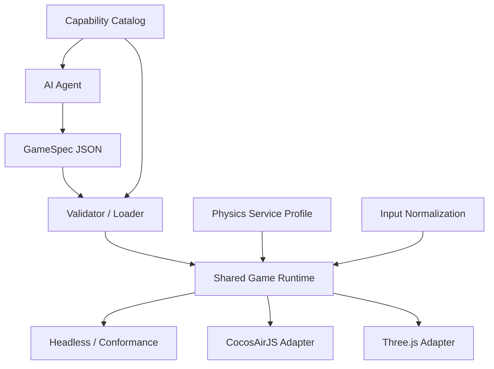

# A2Game V0.1 — 正式协议设计包（协议 0.1.0，现行实现依据）

- 版本：`0.1.0`（初始包标记 `0.1.0-draft.1`，2026-10-24）
- 日期：2026-10-24 初版；本页状态更新于 2026-10-28
- 目标：AI 直接生成引擎无关 JSON，由共享 Game Runtime 解释，CocosAirJS / Three.js 作为可替换适配器；覆盖益智、休闲、轻量射击、塔防、合成、经营，Touch / IMU 是正式输入通道。
- 状态（2026-10-28）：本目录是**现行协议 0.1.0 的规范与机器可读资产**。共享 Runtime、双 SDK Adapter、输入规范化与 Conformance 均已实现，持续通过 `npm test`、`spec:validate`、`schema:full`、`conformance` 验证。项目整体仍为 **Alpha 参考实现**：正式 verified（0/32＋0/5）、正式独立 G3（0/37）、人工质量与真机 Gate 独立验收，不代表官方标准发布。

## 阅读顺序及规范层级

| 顺序 | 文件 | 规范对象 |
|---|---|---|
| 1 | [`docs/01-GameSpec-V0.1.md`](docs/01-GameSpec-V0.1.md) | GameSpec 内容结构与语义 |
| 2 | [`docs/02-Capability-Manifest-V0.1.md`](docs/02-Capability-Manifest-V0.1.md) | 能力目录、版本协商、Touch / IMU / 模块扩展 |
| 3 | [`docs/03-Runtime-Tick-Rule-Semantics-V0.1.md`](docs/03-Runtime-Tick-Rule-Semantics-V0.1.md) | Tick、规则、冲突、随机、状态与生命周期 |
| 4 | [`docs/04-Conformance-Test-V0.1.md`](docs/04-Conformance-Test-V0.1.md) | 基线测试、黄金样例、跨引擎适配验收 |
| 附录 | [`docs/05-Coverage-Registry-V0.1.md`](docs/05-Coverage-Registry-V0.1.md) | 32 个候选游戏 + 未来扩展覆盖数据模型 |

## 机器可读资产

- `schemas/`：采用 JSON Schema Draft 2020-12 的 7 份结构 Schema；跨字段语义约束由 `src/validator.ts`、`src/registry.ts` 与 `scripts/preflight.py`（`npm run schema:full`）执行。
- `samples/games/`：112 份现行游戏 GameSpec JSON（`specVersion` 均为 `0.1.0`），由共享 Runtime 解释执行。
- `samples/capabilities/`：127 份能力 Manifest；能力协商与可信绑定见 `src/registry.ts`、`src/trusted-modules.ts`。
- `samples/tests/`：Conformance 套件、RNG 黄金向量、InputTrace 与负例（含 `negative-fixtures.json`）；实际执行由 `scripts/run-conformance.mjs`（`npm run conformance`）完成并通过。
- `samples/tests/touch-imu.input-trace.json`：Touch + IMU 标准化录制格式样例（采样数据为合成示例；真机采集 Gate 独立验收）。
- `samples/coverage/games.json`：32 个候选玩法的登记数据；真实验收回执指针在 `project/` 与 `reports/`。
- `samples/coverage/not-run.receipt.json`：NOT_RUN 回执的**格式样例**（历史格式演示，非当前状态描述）。
- `samples/adapters/*.adapter.json`：CocosAirJS / Three.js / 公开回合房间的适配器声明；原生 Adapter 实现见 `player/adapters/`，真实 SDK 证据见 `reports/`。
- `tools/validate_specs.py`：JSON / Schema / 静态交叉引用校验（`npm run spec:validate`），不启动游戏。
- `tools/build_artifacts.py`：重建 Schema / 示例数据，便于规范修订后重验。

### 离线验证

```bash
python -m pip install jsonschema
python tools/validate_specs.py
```

注意：`spec:validate` PASS 仅证明静态格式与引用规则；玩法与跨引擎兼容由 `npm test`、`npm run conformance`、真实 SDK G2（`npm run g2:real`）及逐款验收链路证明。

## 当前状态（2026-10-28）

- 规范文档已扩展至 20 份（`docs/01` ~ `docs/20`，含 Puzzle/Realtime/Strategy 库、Mobile Input、Game Candidates、Agent Workflow、Compatibility Extensions、Tower Defense、Rigid3D 等）。
- `samples/games/` 112 份、`samples/capabilities/` 127 份、32 款候选登记；Conformance、完整 Schema、Node/Host Hash 与真实双 SDK 浏览器证据持续通过（回执见 `project/status.json` 与 `reports/`）。
- 正式验收维度独立：正式 verified 0/32＋0/5、正式独立 G3 0/37、人工质量与真机 NOT_RUN；项目整体为 Alpha 参考实现。

## 初始交付范围（2026-10-24 draft.1，历史记录）

1. 统一 `specVersion = 0.1.0`、能力精确版本引用与可扩展的 CoverageRegistry。
2. 提供 7 份结构 Schema、1 份最小 GameSpec、7 份能力 Manifest、2 份 Conformance Suite、RNG 黄金向量、Touch/IMU InputTrace、32 条候选玩法以及未运行回执。
3. 提供静态交叉校验（已测试）；初始包**未包含**游戏运行时与 Adapter，后续阶段已补齐。

## 四层边界



- A2Game 拥有：逻辑状态、规则解释、时钟、事件、随机、玩法模块和测试标准。
- 适配器拥有：画面、材质、粒子、声画呈现、设备事件采样和宿主资源生命周期。
- 物理/导航属于独立服务，尽可能同一实现；不能因共享 JSON 就假定不同求解器数值一致。

## 规范冲突处理

- 这四份文件共同构成 `0.1.0-draft.1`，不存在以“某份文档默认值”为由覆盖另一份的规则。
- 结构字段以 GameSpec 和 Manifest 文档为准；Tick/Rule 行为以 Runtime 文档为准；验证结果判定以 Conformance 文档为准。
- 如出现冲突，属于**规范缺陷**，必须修改两份文档和相关 test vector 后才能标记已解决；不允许实现自行择一。

## 明确不在 V0.1 已实现范围内

多人网络同步、任意用户脚本执行、独立视觉编辑器、跨物理后端 bit-exact、任意已有 TS 游戏的无损反向导出。有界例外：S11 提供显式启用的同源 loopback 双人公开回合（`scripts/turn-room-service.mjs`，非互联网/隐藏信息服务）；`/player/inspect.html` 是调试回放入口而非视觉编辑器；参考物理锁定 cannon-es 0.20.0，未声明平台的浮点精确一致性不自动推定。可以通过扩展能力进行未来设计，但不默示这些能力已提供。

## 来源与原创边界

协议是本项目的设计稿。参考 [A2UI Catalogs](https://a2ui.org/concepts/catalogs/)、[Yume 的世界模型/一致性契约](https://github.com/kamwoh/yume/blob/dev/docs/guideline/30_framework_primitives.md)、[JSON Schema 2020-12](https://json-schema.org/draft/2020-12)、[W3C Pointer Events 3](https://www.w3.org/TR/pointerevents3/)、[MDN DeviceMotionEvent](https://developer.mozilla.org/en-US/docs/Web/API/DeviceMotionEvent)，而非复用其协议或宣称兼容。
